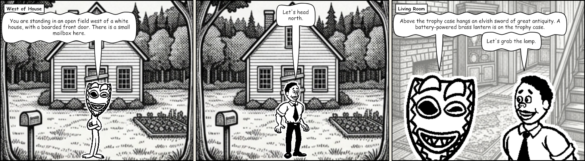

# Grues in Comic

> Zork I and Microsoft Comic Chat — two historical Microsoft open-source releases — rebuilt as a
> browser-native comic adventure. You type at the 1977 parser; a 1996 comic engine draws what
> happens.



**[Play it →](https://grues.danielkimdev.com)** · [Changelog](CHANGELOG.md) · [Documentation](docs/README.md)

## What this is

Zork I's original ZIL source supplies the world. Comic Chat's panel-and-balloon engine draws it.
Every command you type produces a comic panel beside the transcript — the room you are in, the
Dungeon Master reading the description, and the Hero answering him.

It is **not** a Z-machine emulator and **not** a source port. The ZIL is parsed, its gameplay
semantics are extracted into a runtime-independent Intermediate Representation, and a TypeScript
engine executes that IR in the browser. The result is checked turn-for-turn against transcripts from
the original 1980s binary: **151/151 strict parity**, and the game is completable — 350 out of 350
points, verified in the test suite on every run.

The project is also a working record of AI-assisted modernization: how legacy source can be
understood, its semantics extracted, and a maintainable browser application built from them.

## Status

| | |
|---|---|
| **Zork I** | Playable start to finish in a browser, 350/350 points |
| **Parity** | 151/151 strict against the original binary's transcripts |
| **Comic pane** | Every turn draws a panel — Comic Chat figures, Woodring balloons, a dedicated backdrop for all 110 rooms |
| **Cast** | Pick which of eight Heroes and seven Dungeon Masters plays the part |
| **Hall of Fame** | A live board of recent and finished runs — see [`wiki/hall-of-fame.md`](wiki/hall-of-fame.md) |
| **Save / restore** | Autosave plus named slots, in browser storage |
| **Version** | Pre-1.0. `1.0.0` is reserved for the public launch |

## Try it locally

```sh
git clone https://github.com/dkdev24/grues-in-comic.git
cd grues-in-comic
pnpm -C web install
pnpm -C web run dev      # → http://localhost:8080/play/
```

Tests, per package: `pnpm -C engine test` (the engine and its parity suite),
`pnpm -C web test` (the comic mapping), `pnpm -C ir test` (the IR schema).
The engine has **zero runtime dependencies**; everything under `devDependencies` is tooling.

---

## Why it was built this way

Rather than emulating the Z-machine, Grues in Comic extracts the original's semantics into an IR and
executes them on a new runtime. That choice is what makes the comic possible: an emulator produces
*text*, while an IR-executing engine can emit **semantic events** — `player-moved`, `narration`,
`score-changed` — which is what a comic renderer needs in order to know that this turn is an
arrival, and that one is a death.

The decisions behind that, and the ones that follow from it, are recorded as ADRs in
[`docs/adr/`](docs/adr/) — eleven of them, each with its alternatives and its consequences.

### How it compares

| | What it is | How it renders | Parity method |
|---|---|---|---|
| **Grues in Comic** | Not a Z-machine implementation: the ZIL's gameplay semantics are extracted into a runtime-independent IR, executed by a browser-native TypeScript engine | A comic strip — every turn draws a panel with Comic Chat figures, Woodring balloons, and a backdrop for each of the 110 rooms | 151/151 strictly checked turns match the original binary's transcripts, byte for byte |
| **Z-machine interpreters** (Frotz, ZLR, ZVM) | Run the compiled story file — an opaque memory image — against the Z-machine specification | The game's original text, as Infocom wrote it | Faithful execution of the specification |
| **ZILF rebuild** | Recompile the original ZIL sources with ZILF — the compiler this project uses as its build oracle instead of reinventing | Text: the compiled story file still needs an interpreter to play | Same as the interpreter it runs on |

---

## Architecture

```text
Historical Source Code
        │
        ▼
 Semantic Analysis
        │
        ▼
Intermediate Representation (IR)
        │
        ▼
 Grues in Comic Engine  (TypeScript, zero runtime deps)
        │
        ▼  JSON event stream (versioned engine↔UI contract)
        │
 Browser Application  (text UI · comic renderer)
```

The engine is a pure, deterministic, synchronous state machine — no DOM, no
timers, no rendering vocabulary. It emits semantic events (`narration`,
`speech`, `player-moved`, …) that a UI layer maps to text or comic panels.
"Browser-native" is achieved by being JavaScript, not by compiling to
WebAssembly; see ADR 0002 for the reasoning and the full contract.

---

## Repository Structure

```text
grues-in-comic/

├── original-projects/     historical source, version-controlled
│   ├── zork1/             ZIL source (MIT, Microsoft)
│   └── comic-chat/        Comic Chat source + art (MIT, Microsoft)
│
├── importer/              ZIL parser → AST artifacts
├── ir/                    IR schema, validator, extraction → world document
├── engine/                the IR runtime — parser, world state, event stream
├── art/                   Comic Chat art tooling: decode, pose, pack
├── web/                   browser shell + comic renderer (the deployed site)
│
├── verification/          the parity oracle — golden transcripts from the original binary
├── docs/                  ADRs, specs, plans — start at docs/README.md
└── reference/             third-party reference material (gitignored)
```

Every module carries its own `README.md` and its own Graphify knowledge graph in
`<module>/graphify-out/`. [`verification/README.md`](verification/README.md) explains how parity is
established and what "strict" does and does not mean.

---

## AI knowledge system

The project separates two kinds of knowledge about itself, and keeps them in different places on
purpose.

**Structural knowledge** — dependency, call and architecture graphs — is *generated* by
[Graphify](docs/AI_KNOWLEDGE_INFRASTRUCTURE_DECISION.md) into a per-module `graphify-out/`. It
answers *how the system is organized*, and is never hand-edited.

**Semantic knowledge** — gameplay rules, parser behavior, design rationale — is hand-authored in
[`wiki/`](wiki/). It answers *why the system is that way*.

The generated half is cheap and always current; the authored half is expensive and deliberate.
Keeping them apart is what stops the second from rotting into a stale copy of the first.

---

## Questions and contributions

This is a solo project, built session by session with AI coding agents. Questions, bug reports and
"the parser did something strange" transcripts are welcome as GitHub issues — a reproducible
divergence from the original game is the most useful thing anyone can send.

Pull requests are read, but the project's shape is governed by the ADRs in [`docs/adr/`](docs/adr/):
a change that contradicts one needs the ADR amended first, and that is a conversation before it is a
patch. [`AGENTS.md`](AGENTS.md) documents the working rules the repository actually runs on,
including what belongs in which document.

---

## Provenance and Licensing

Grues in Comic is released under the **Apache License 2.0**. Imported historical
projects retain their original licenses. `LICENSE`, `NOTICE`, and
`THIRD_PARTY.md` carry the authoritative details; this section is the map.

### What is in this repository

| Source | License | Why it is here |
|---|---|---|
| [Zork I](https://github.com/historicalsource/zork1) — `original-projects/zork1/` | MIT (Copyright (c) 2025 Microsoft) | The ZIL corpus every artifact is derived from. `importer/` parses it, `ir/` extracts from it, `verification/` compiles it |
| [Microsoft Comic Chat](https://github.com/microsoft/comic-chat) — `original-projects/comic-chat/` | MIT (Copyright (c) Microsoft Corporation) | The comic renderer's source of truth: its panel and balloon algorithms are ported from this source, and its character art is decoded and **redistributed** in converted form as the sprite sheets under `web/assets/comic/` |

Both are redistributed here under the terms of their MIT grants. They are
version-controlled deliberately — the pipeline reads from them, so a checkout
without them cannot reproduce the artifacts in `importer/artifacts/` or
`ir/artifacts/`.

### What is deliberately absent

**Comic Chat build outputs.** Compiled `.exe`, `.dll`, `.ocx`, `.lib`,
`.class`, `.map`, and `.sym` files were untracked in v0.5.17, along with a
vendored copy of Sun's JDK 1.1.4 (`artifacts/jchat/jdk114/lib/classes.zip`)
that Microsoft's MIT grant does not extend to. All are build products of source
that remains in the tree. Source, documentation, and comic art
(`.avb`, `.bmp`, `.gif`, `.jpg`, `.ico`) are untouched. They remain in the
upstream repository if you need them.

**Third-party reference material** (`reference/`, gitignored). Local-only
copies of the Z-Machine Standards Document, the Comic Chat SIGGRAPH '96 paper,
and the ZILF/ZLR sources. Not redistributed: the paper is an ACM publication,
ZILF is GPL-3.0, and ZLR ships no license at all. Nothing in the build depends
on this directory. See `THIRD_PARTY.md` and ADR 0002.

### Build tools

The verification pipeline invokes **ZILF/ZAPF 0.11.1** (GPL-3.0) and
**Frotz/dfrotz 2.55** (GPL-2.0-or-later) as external executables to compile the
ZIL source and generate golden transcripts. Neither is vendored, linked, or
redistributed here, so their copyleft terms do not extend to this project's
source. Install them separately; see `verification/build.sh`.

### Relationship to existing Z-machine tooling

This project is **not** a Z-machine implementation and does not reimplement
one. A compiled story file is an opaque memory image; this project extracts the
*semantics* of the original ZIL into a runtime-independent IR so the engine can
emit events a comic renderer can draw. ZILF is used as the build oracle rather
than reinvented. ADR 0002 records the full reasoning, including why an existing
interpreter such as ZLR or ZVM would not serve the goal.

### Trademarks

ZORK is a trademark of Activision Publishing, Inc. INFOCOM is a trademark of
Activision Publishing, Inc. MICROSOFT and COMIC CHAT are trademarks of the
Microsoft group of companies. All other trademarks are the property of their
respective owners.

This project is an independent work. It is **not** affiliated with, sponsored
by, endorsed by, or approved by Activision Publishing, Inc., Microsoft
Corporation, or any of their affiliates.

The MIT licenses covering the imported Zork I and Comic Chat source grant
copyright permissions only; they convey no trademark rights. Trademark names
appear in this repository solely for **nominative, descriptive purposes** — to
identify the historical works this project modernizes and to reproduce original
program output faithfully (for example, the `ZORK I: The Great Underground
Empire` status banner, which golden-transcript parity requires). Such use does
not imply any claim to those marks or any endorsement by their owners.

The project name "Grues in Comic" is not derived from any trademark of
Activision or Microsoft.
